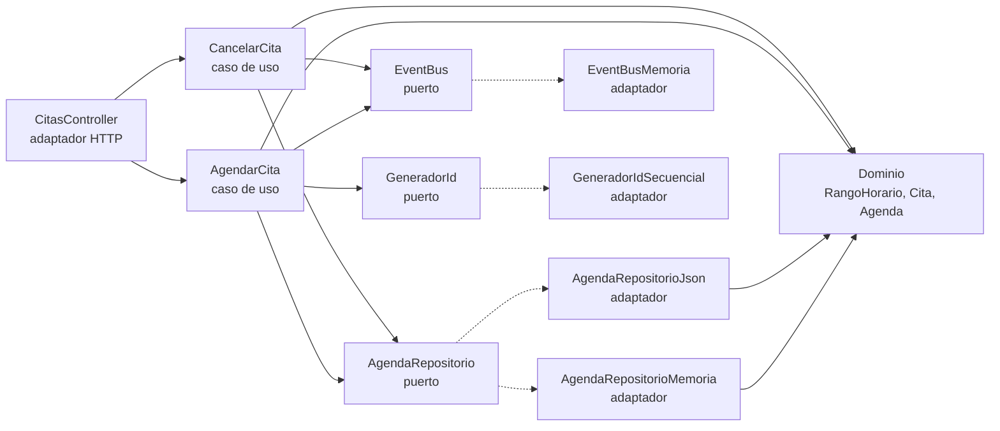
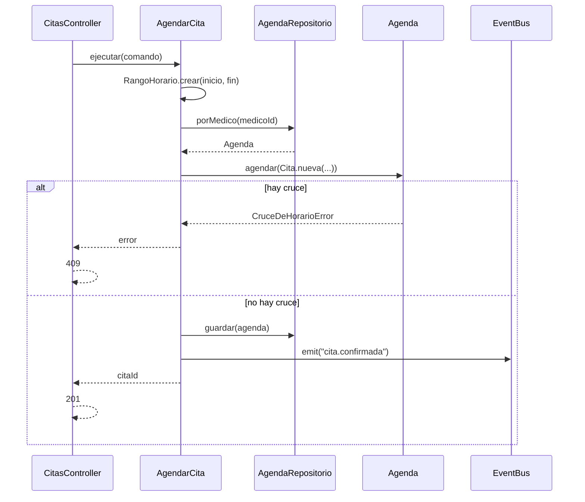

# Informe de laboratorio

## Arquitectura hexagonal en SaludYa

**Institución:** ______________________________________

**Asignatura:** ______________________________________

**Fecha:** ______________________________________

**Grupo:** 5

**Integrantes:** Andrés Gómez, Deyner Ortiz y Juan Pablo Montez

**Repositorio:** <https://github.com/Deyner3267/Laboratorio-SaludYa>

**Pull request de entrega:** <https://github.com/Deyner3267/Laboratorio-SaludYa/pull/1>

**Fecha de consulta de las fuentes:** 14 de noviembre de 2026

---

## 1. Portada

Este informe documenta el laboratorio de arquitectura hexagonal aplicado a la agenda de citas de SaludYa. La portada anterior deja espacios para que la institución, la asignatura y la fecha sean completados por el docente o por el grupo.

El trabajo se analiza a partir de dos referencias verificables:

- El repositorio público `Deyner3267/Laboratorio-SaludYa`.
- El pull request número 1, titulado “Implementar agenda hexagonal de SaludYa”.

El repositorio es material de práctica: no contiene una base de datos real, un servicio de correo real ni datos personales reales. La persistencia es en memoria o en un archivo JSON.

## 2. Objetivo y alcance del laboratorio

### 2.1 Objetivo general

Documentar y analizar la implementación de la agenda de citas de SaludYa con arquitectura hexagonal, identificando cómo se separan las reglas de negocio, los casos de uso, los puertos y los adaptadores, y cómo se comprueba el comportamiento del sistema.

### 2.2 Objetivos específicos

1. Describir la estructura del dominio, la aplicación, los puertos, los adaptadores y la composición.
2. Explicar las decisiones de arquitectura visibles en el código y su relación con la regla de dependencia.
3. Detallar el funcionamiento de agendar y cancelar citas, incluida la regla que impide cruces de horarios.
4. Comparar los repositorios de agenda en memoria y en archivo JSON.
5. Presentar la verificación ejecutada con `npm test` y `npm run typecheck`.
6. Resumir los tres comentarios de revisión publicados en el pull request, sin atribuirlos a quien elabora este informe.
7. Registrar conclusiones y enlaces a las fuentes.

### 2.3 Alcance

El alcance corresponde a la implementación de `src/` en la rama `feat/agenda-hexagonal`, junto con las pruebas y la documentación del repositorio. El lenguaje es TypeScript y el marco de pruebas es Vitest.

Quedan fuera del alcance:

- Una base de datos real o un servicio externo real.
- Autenticación, autorización y gestión de usuarios.
- Interfaz gráfica o aplicación móvil.
- Envío real de correos o notificaciones.
- Despliegue en producción, auditoría de seguridad o pruebas de carga.
- Control de concurrencia o transacciones distribuidas.

### 2.4 Material base e implementación propuesta

| Elemento | Rama `main` (material base) | Rama `feat/agenda-hexagonal` (implementación propuesta) |
| --- | --- | --- |
| `src/` | No existe | Implementado: dominio, aplicación, infraestructura y composición |
| `README.md` | No existe | Agregado en la rama |
| `AGENTS.md` | No existe | Agregado en la rama |
| `test/` | Presente, con 9 archivos de pruebas | Sin cambios respecto de `main` |
| `casos/`, `docs/` | Presentes | Sin cambios |
| `package.json`, `package-lock.json`, `tsconfig.json` | Presentes | Sin cambios |
| Estado de las pruebas | El `README.md` de la entrega indica que el material base llegó sin `src/` y con las pruebas en rojo | 34 de 34 pruebas aprobadas en la verificación de este informe |

La separación anterior es importante: el material base aporta el escenario, las pruebas y la configuración; la rama de trabajo agrega la implementación de `src/` y la documentación de entrega. El diff entre `main` y `feat/agenda-hexagonal` no modifica ningún archivo de `test/`.

### 2.5 Nota de trazabilidad

El historial de commits disponible está firmado por el usuario `Deyner3267`. El repositorio no documenta aportes individuales de los demás integrantes, por lo que este informe no atribuye partes del código a una persona específica. Los nombres de los integrantes se incluyen en la portada porque así fueron indicados para el laboratorio, no como una afirmación sobre autoría individual.

Tampoco se afirman reuniones, cronogramas o actividades de equipo que no estén registrados en las fuentes consultadas.

## 3. Arquitectura hexagonal del proyecto

### 3.1 Idea central

La arquitectura hexagonal, también llamada de puertos y adaptadores, organiza el sistema alrededor de un núcleo con las reglas de negocio. El núcleo no depende de la base de datos, del framework web ni del sistema de archivos. Se comunica con el exterior mediante puertos, que son contratos, y los adaptadores implementan esos contratos.

La dirección de dependencias del proyecto es:

```text
infrastructure → application → domain
```

El dominio es la parte más interna y no importa nada de fuera de `src/domain/`. La aplicación importa del dominio y de sí misma. La infraestructura implementa los puertos y puede depender del dominio y de la aplicación. `src/composicion.ts` es el único lugar que decide qué adaptador concreto se utiliza.

### 3.2 Mapa de componentes



### 3.3 Dominio

El dominio contiene las reglas que no dependen de la persistencia ni de la interfaz.

| Archivo | Responsabilidad |
| --- | --- |
| `src/domain/rango-horario.ts` | Objeto de valor que representa un intervalo con inicio y fin, valida que el fin sea posterior al inicio y decide si dos rangos se cruzan. |
| `src/domain/cita.ts` | Entidad que representa una cita con identidad, paciente, rango y estado `confirmada` o `cancelada`. |
| `src/domain/agenda.ts` | Agregado que reúne las citas de un médico, rechaza cruces entre citas activas y permite cancelar una cita existente. |
| `src/domain/errores.ts` | Errores de negocio: rango inválido, cita ya cancelada, cruce de horario y cita no encontrada. |
| `src/domain/agenda-repositorio.ts` | Puerto `AgendaRepositorio`, con las operaciones `porMedico` y `guardar`. |

Detalles verificables:

- `RangoHorario` guarda milisegundos internamente y devuelve nuevas instancias de `Date` en sus getters, por lo que no expone sus fechas internas.
- `RangoHorario.crear` rechaza fechas no finitas y rangos donde `fin <= inicio`.
- `Cita` solo puede cancelarse una vez; un segundo intento produce `CitaYaCanceladaError`.
- `Agenda.agendar` revisa únicamente las citas activas; una cita cancelada no bloquea el horario.
- `Agenda.citas()` devuelve una copia del arreglo para que un cambio externo no altere el estado interno.

### 3.4 Aplicación

La aplicación contiene los casos de uso y los puertos que el núcleo necesita para hablar con el exterior.

| Archivo | Responsabilidad |
| --- | --- |
| `src/application/agendar-cita.ts` | Caso de uso `AgendarCita`, con el comando `ComandoAgendarCita`. |
| `src/application/cancelar-cita.ts` | Caso de uso `CancelarCita`, con el comando `ComandoCancelarCita`. |
| `src/application/puertos.ts` | Puertos `EventBus` y `GeneradorId`. |

`AgendarCita` depende de tres contratos: `AgendaRepositorio`, `EventBus` y `GeneradorId`. `CancelarCita` depende de `AgendaRepositorio` y `EventBus`. Ninguno de los dos importa una clase concreta de infraestructura.

### 3.5 Puertos

| Puerto | Ubicación | Operaciones | Implementaciones |
| --- | --- | --- | --- |
| `AgendaRepositorio` | `src/domain/agenda-repositorio.ts` | `porMedico(medicoId)`, `guardar(agenda)` | `AgendaRepositorioMemoria`, `AgendaRepositorioJson` |
| `EventBus` | `src/application/puertos.ts` | `emit(nombre, datos)` | `EventBusMemoria` |
| `GeneradorId` | `src/application/puertos.ts` | `nuevo()` | `GeneradorIdSecuencial` |

`AgendaRepositorio` se ubica en el dominio porque expresa una necesidad del núcleo: recuperar y guardar agendas. `EventBus` y `GeneradorId` se ubican en la aplicación porque son necesidades de coordinación de los casos de uso.

### 3.6 Adaptadores

| Adaptador | Ubicación | Función |
| --- | --- | --- |
| `CitasController` | `src/infrastructure/http/citas-controller.ts` | Recibe una solicitud de agendamiento, valida campos y fechas, y traduce errores de dominio a estados HTTP. |
| `AgendaRepositorioMemoria` | `src/infrastructure/persistence/agenda-repositorio-memoria.ts` | Guarda agendas en un `Map` y devuelve copias. |
| `AgendaRepositorioJson` | `src/infrastructure/persistence/agenda-repositorio-json.ts` | Lee y escribe un archivo JSON, reconstruye citas y rangos. |
| `EventBusMemoria` | `src/infrastructure/messaging/event-bus-memoria.ts` | Acumula los eventos emitidos en un arreglo. |
| `GeneradorIdSecuencial` | `src/infrastructure/id/generador-id-secuencial.ts` | Genera identificadores `cita-1`, `cita-2`, etc. |

El controlador HTTP incluido en el material expone el agendamiento mediante `post`. La cancelación existe como caso de uso y se prueba directamente; el repositorio no incluye un endpoint HTTP de cancelación.

### 3.7 Composición

`src/composicion.ts` define:

```ts
export type Persistencia =
  | { tipo: "memoria" }
  | { tipo: "json"; ruta: string };
```

La función `crearApp` recibe una opción de persistencia, elige el adaptador correspondiente, construye el bus de eventos y el generador de identificadores, y arma los casos de uso y el controlador. Es el único archivo de `src/` que importa adaptadores concretos de infraestructura.

### 3.8 Regla de dependencia comprobada

`test/arquitectura.test.ts` funciona como una prueba de aptitud arquitectónica. Comprueba que:

1. Existe código de dominio y de aplicación para revisar.
2. El dominio no importa nada fuera de `src/domain/`, ni siquiera módulos de Node.
3. La aplicación solo importa del dominio y de la aplicación.
4. Los adaptadores de una carpeta de infraestructura no importan adaptadores de otra carpeta.
5. Solo `composicion.ts` decide qué adaptador concreto se usa.

Estas comprobaciones se ejecutan junto con las demás pruebas y forman parte del resultado de 34 de 34 pruebas aprobadas.

## 4. Decisiones de arquitectura y justificación

La siguiente tabla relaciona cada decisión visible en el código con su justificación y su evidencia. No se presentan como actas de reunión ni como alternativas que el equipo haya comparado formalmente, porque el repositorio no documenta esa comparación.

| Decisión | Justificación | Evidencia |
| --- | --- | --- |
| Mantener el dominio puro | Las reglas de horarios, citas y agenda pueden probarse sin base de datos, archivos, red ni framework. | `src/domain/` solo importa archivos de `src/domain/`; lo vigila `test/arquitectura.test.ts`. |
| Ubicar `AgendaRepositorio` en el dominio | El núcleo define qué necesita para persistir, no al revés. | `src/domain/agenda-repositorio.ts`. |
| Ubicar `EventBus` y `GeneradorId` en la aplicación | Son necesidades de coordinación de los casos de uso, no reglas del negocio. | `src/application/puertos.ts`. |
| Hacer que los casos de uso dependan de interfaces | Permiten sustituir adaptadores y usar dobles de prueba sin cambiar la lógica. | Constructores de `AgendarCita` y `CancelarCita`; `test/fakes.ts`. |
| Concentrar la elección de adaptadores en `composicion.ts` | Evita que dominio y aplicación conozcan detalles de persistencia o mensajería. | `src/composicion.ts`; prueba de arquitectura que prohíbe importar infraestructura desde otras capas. |
| Devolver copias y reconstruir objetos al persistir | Evita que cambios posteriores en un objeto en memoria modifiquen lo almacenado sin llamar a `guardar`. | `AgendaRepositorioMemoria.copiar`; `Agenda.citas()`; prueba de contrato “cambiar la agenda leída no cambia lo guardado hasta que se guarda”. |
| Modelar el horario como objeto de valor | La validación y la regla de cruce viven en un único lugar y se reutilizan desde `Agenda`. | `src/domain/rango-horario.ts`; pruebas de `RangoHorario` y `Agenda`. |
| Usar errores de dominio y traducirlos en el adaptador HTTP | La lógica de negocio no depende de códigos HTTP. | `src/domain/errores.ts`; `CitasController.post` traduce a 400 y 409. |
| Compartir una prueba de contrato entre adaptadores | Verifica que memoria y JSON ofrecen el mismo comportamiento observable. | `test/infraestructura/contrato.ts`, ejecutado por `contrato-memoria.test.ts` y `contrato-json.test.ts`. |
| Mantener los commits por etapas y no agregar dependencias | Facilita la revisión y respeta las reglas del repositorio. | Cuatro commits de implementación y documentación; `package.json` sin cambios respecto de `main`. |

Una decisión que no se puede afirmar con las fuentes disponibles es que el equipo haya evaluado y descartado otras arquitecturas. El material no contiene un ADR diligenciado ni una matriz de alternativas. Por eso este informe se limita a justificar las decisiones que el código y el `README.md` permiten observar.

## 5. Funcionamiento de agendar y cancelar citas

### 5.1 Agendar una cita

El flujo de agendamiento es el siguiente:

1. `CitasController.post` recibe `medicoId`, `pacienteId`, `inicio` y `fin`.
2. Si falta algún campo o alguna fecha no se puede interpretar, responde `400`.
3. `AgendarCita.ejecutar` crea un `RangoHorario`. Si el fin no es posterior al inicio, se lanza `RangoInvalidoError` antes de tocar el repositorio.
4. El caso de uso pide la agenda del médico mediante `AgendaRepositorio.porMedico`.
5. Genera un identificador con `GeneradorId.nuevo`.
6. Crea una `Cita` nueva en estado `confirmada`.
7. `Agenda.agendar` revisa las citas activas. Si encuentra un cruce, lanza `CruceDeHorarioError` y no agrega la cita.
8. Si no hay cruce, agrega la cita y `AgendaRepositorio.guardar` persiste la agenda.
9. Se emite el evento `cita.confirmada` con el identificador de la cita y el médico.
10. El controlador responde `201` con el identificador; un cruce se traduce a `409` y un rango inválido a `400`.



### 5.2 Cancelar una cita

1. `CancelarCita.ejecutar` recibe `medicoId` y `citaId`.
2. Recupera la agenda del médico mediante `AgendaRepositorio.porMedico`.
3. `Agenda.cancelar` busca la cita por identificador. Si no existe, lanza `CitaNoEncontradaError`.
4. `Cita.cancelar` verifica que la cita esté activa. Si ya fue cancelada, lanza `CitaYaCanceladaError`; si está activa, cambia su estado a `cancelada`.
5. Guarda la agenda y emite el evento `cita.cancelada`.

La cancelación no elimina la cita del arreglo: cambia su estado. Como `Agenda.agendar` solo considera citas activas, el horario cancelado queda disponible para una nueva cita. Esto se comprueba en `test/dominio/agenda.test.ts` y en `test/aplicacion/cancelar-cita.test.ts`.

### 5.3 Regla que impide cruces de horarios

La regla está en `RangoHorario.seCruzaCon`:

```ts
seCruzaCon(otro: RangoHorario): boolean {
  return this.inicioMs < otro.finMs && otro.inicioMs < this.finMs;
}
```

Dos rangos se cruzan si cada uno empieza antes de que termine el otro. Las comparaciones son estrictas, de modo que dos citas contiguas no se consideran un cruce.

| Caso | Rango existente | Rango nuevo | Resultado |
| --- | --- | --- | --- |
| Citas contiguas | 09:00–09:30 | 09:30–10:00 | Permitido |
| Citas contiguas | 09:00–10:00 | 08:00–09:00 | Permitido |
| Solapamiento parcial | 09:00–10:00 | 09:30–10:30 | Rechazado |
| Solapamiento parcial | 09:00–10:00 | 08:00–09:01 | Rechazado |

Además, `Agenda.agendar` solo revisa citas activas:

```ts
if (this.citasAgendadas.some(
  (existente) => existente.activa() && existente.rango.seCruzaCon(cita.rango),
)) {
  throw new CruceDeHorarioError();
}
```

Por eso una cita cancelada libera su franja. Las pruebas de `RangoHorario` cubren los extremos contiguos y los solapamientos; las pruebas de `Agenda` cubren el rechazo de una cita que se cruza y la liberación del horario al cancelar.

## 6. Comparación entre los repositorios en memoria y JSON

### 6.1 Comparación técnica

| Aspecto | `AgendaRepositorioMemoria` | `AgendaRepositorioJson` |
| --- | --- | --- |
| Almacenamiento | `Map<string, Agenda>` en memoria | Archivo JSON en la ruta indicada |
| Lectura | `Map.get` y copia profunda de la agenda | `readFile`, `JSON.parse` y reconstrucción de citas |
| Escritura | `Map.set` con una copia profunda | Lectura del archivo, actualización de las citas del médico y `writeFile` |
| Persistencia tras reiniciar | No: se pierde al terminar el proceso | Sí: queda en el archivo |
| Dependencias | Solo tipos y clases del dominio | `node:fs/promises`, `node:path` y el dominio |
| Fechas | Se conservan como `Date` dentro del objeto | Se serializan como cadenas ISO y se reconstruyen como `Date` |
| Archivo inexistente | No aplica | Se interpreta como un conjunto vacío de agendas |
| Aislamiento | Copia las citas con `Cita.reconstruir` y nuevos `RangoHorario` | La serialización y deserialización crean objetos nuevos |

### 6.2 Por qué cambiar el adaptador no exige modificar `Agenda` ni `AgendarCita`

`AgendarCita` recibe una dependencia tipada como `AgendaRepositorio`:

```ts
constructor(
  private readonly agendas: AgendaRepositorio,
  private readonly eventos: EventBus,
  private readonly ids: GeneradorId,
) {}
```

El caso de uso solo conoce las operaciones `porMedico` y `guardar`. No importa `AgendaRepositorioMemoria` ni `AgendaRepositorioJson`. `Agenda`, por su parte, es una clase de dominio y no importa ningún adaptador.

La elección concreta se hace en `composicion.ts`:

```ts
const agendas: AgendaRepositorio = persistencia.tipo === "memoria"
  ? new AgendaRepositorioMemoria()
  : new AgendaRepositorioJson(persistencia.ruta);
```

Así, cambiar de memoria a JSON consiste en cambiar la opción que recibe `crearApp`:

```ts
crearApp({ tipo: "memoria" });
crearApp({ tipo: "json", ruta: "datos/agendas.json" });
```

El código de `Agenda` y de `AgendarCita` no cambia porque ambos dependen del contrato, no de la implementación. Esta es una aplicación de inversión de dependencias: el núcleo define el puerto y la infraestructura lo implementa.

La prueba de arquitectura refuerza la separación: dominio y aplicación no pueden importar `infrastructure`, y solo `composicion.ts` puede elegir el adaptador. La prueba de intercambio (`test/infraestructura/intercambio.test.ts`) ejecuta el mismo escenario con memoria y con JSON, y obtiene los mismos estados HTTP, la misma agenda y el mismo evento. Las pruebas de contrato (`test/infraestructura/contrato.ts`) aplican la misma batería a ambos adaptadores.

### 6.3 Diferencias observables y límites

- La memoria es más simple y no requiere archivos, pero pierde los datos al reiniciar.
- JSON permite conservar los datos entre ejecuciones, a cambio de lectura y escritura de archivo en cada operación.
- El adaptador JSON reescribe el archivo completo en cada `guardar`; no se observa un mecanismo de bloqueo o control de concurrencia.
- Ambos adaptadores cumplen el mismo contrato observable, que es lo que permite sustituirlos sin tocar el dominio ni los casos de uso.

## 7. Verificación

### 7.1 Comandos ejecutados

La verificación se realizó sobre una copia temporal de la rama `feat/agenda-hexagonal`, después de instalar las dependencias con `npm install`. No se modificaron las pruebas ni el código original.

| Comando | Resultado obtenido |
| --- | --- |
| `npm test` | 9 archivos de prueba aprobados; 34 de 34 pruebas aprobadas |
| `npm run typecheck` | Sin errores; finalizó con código de salida 0 |
| `git diff main..feat/agenda-hexagonal -- test` | Sin diferencias: las pruebas no se modificaron |

Entorno de ejecución: Node.js v24.19.0 y npm 11.17.0. El proyecto declara Node.js 20 o superior en `package.json`.

### 7.2 Detalle de las pruebas

| Archivo | Pruebas aprobadas |
| --- | ---: |
| `test/arquitectura.test.ts` | 5 |
| `test/dominio/rango-horario.test.ts` | 6 |
| `test/dominio/cita.test.ts` | 3 |
| `test/dominio/agenda.test.ts` | 5 |
| `test/aplicacion/agendar-cita.test.ts` | 4 |
| `test/aplicacion/cancelar-cita.test.ts` | 1 |
| `test/infraestructura/contrato-memoria.test.ts` | 4 |
| `test/infraestructura/contrato-json.test.ts` | 4 |
| `test/infraestructura/intercambio.test.ts` | 2 |
| **Total** | **34** |

### 7.3 Resultado reportado y resultado verificado

El `README.md` de la rama y el cuerpo del pull request reportan 34 de 34 pruebas aprobadas y typecheck sin errores. Esos resultados no se tomaron como propios: para este informe se ejecutaron los comandos en una copia independiente y se obtuvo el mismo resultado.

La verificación confirma el comportamiento descrito, pero no convierte el laboratorio en un sistema productivo. Se trata de un ejercicio académico con persistencia simulada y sin integraciones reales.

## 8. Revisión de código

En el pull request número 1 constan tres comentarios de revisión publicados. La consulta a la API de GitHub los devuelve como comentarios de revisión, no como comentarios generales del issue. Fueron escritos por el usuario `Deyner3267`; no fueron realizados por quien elabora este informe.

| # | Archivo y línea | Resumen del comentario |
| --- | --- | --- |
| 1 | `src/domain/rango-horario.ts:31` | Revisa la condición de cruce: ahora permite citas consecutivas sin que se crucen y rechaza las que comparten parte del horario. |
| 2 | `src/infrastructure/persistence/agenda-repositorio-memoria.ts:15` | Al guardar una copia de la agenda se evita que cambios posteriores en el objeto original modifiquen los datos almacenados sin llamar otra vez a `guardar`. |
| 3 | `src/composicion.ts:13` | La elección entre memoria y JSON está concentrada en `composicion.ts`; ambos implementan `AgendaRepositorio`, así que `AgendarCita` y `Agenda` no necesitan cambiar al sustituir el almacenamiento. |

Los tres comentarios se publicaron el 14 de noviembre de 2026. El cuerpo del pull request todavía dice que los comentarios debían realizarse; sin embargo, la API confirma que ya están publicados. Esa diferencia es una desactualización del texto del PR, no una ausencia de los comentarios.

Los comentarios se relacionan directamente con tres puntos centrales del laboratorio:

1. La regla de cruces y los horarios contiguos.
2. El aislamiento del estado en el repositorio de memoria.
3. La sustitución de persistencia mediante la composición.

## 9. Conclusiones y enlaces

### 9.1 Conclusiones

- La implementación separa las reglas de negocio en `src/domain/`, la coordinación en `src/application/`, los detalles técnicos en `src/infrastructure/` y el armado en `src/composicion.ts`.
- La regla de cruces permite citas contiguas y rechaza intervalos que comparten tiempo. La cancelación cambia el estado de la cita y libera el horario porque las citas canceladas no se consideran activas.
- Memoria y JSON implementan el mismo puerto `AgendaRepositorio`. Cambiar de uno a otro solo requiere ajustar la composición; `Agenda` y `AgendarCita` no necesitan modificarse.
- La verificación ejecutada para este informe dio 34 de 34 pruebas aprobadas en 9 archivos y typecheck sin errores.
- Las pruebas originales no se modificaron: el diff entre `main` y la rama de trabajo no contiene cambios en `test/`.
- El pull request está abierto y no fusionado al momento de la consulta. Los tres comentarios de revisión están publicados, aunque el cuerpo del PR no se haya actualizado.
- El laboratorio es un ejemplo académico: no hay base de datos real, correo real, autenticación, interfaz gráfica ni control de concurrencia. Estas ausencias delimitan el alcance de las conclusiones.

### 9.2 Enlaces

- Repositorio público: <https://github.com/Deyner3267/Laboratorio-SaludYa>
- Rama de la implementación: <https://github.com/Deyner3267/Laboratorio-SaludYa/tree/feat/agenda-hexagonal>
- Pull request de entrega: <https://github.com/Deyner3267/Laboratorio-SaludYa/pull/1>

---

**Nota final:** este informe se basa en el estado del repositorio y del pull request consultados el 14 de noviembre de 2026. Los espacios de institución, asignatura y fecha de la portada quedan pendientes de completar.
